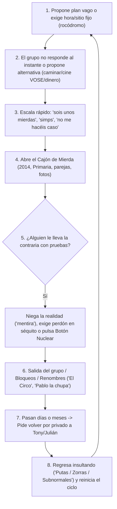

# Expediente Forense de *El Puto Circo*: Anatomía Completa de Daniel Bruno (`GM` / `Perchita` / `El Prensas`)

> [!IMPORTANT]
> **Alcance auditado:** Se han procesado y verificado los **56.941 registros** íntegros del historial exportado de WhatsApp (`56.630` mensajes reales de usuario + `311` eventos de sistema, corrigiendo un fragmento ficticio generado con IA que Pablo pegó el `23/03/2025`), abarcando desde el **21 de mayo de 2022** hasta el **16 de octubre de 2026** (**4 años y 5 meses**).

---

## Prólogo: La Tragedia Griega en Cuatro Actos

El **21 de mayo de 2022 a las 07:33 de la mañana**, Daniel Bruno —alias *El Prensas*, posteriormente ascendido a *Perchita* y finalmente canonizado en los altares del meme como **GM (*Guarra Mayor* → *Gordus Mamonis Mamonis*)**— fundó un nuevo grupo llamado `"Pablo otako "` que a los dos minutos rebautizó como `"Se acabó la dictadura"`. Su manifiesto fundacional era digno de la Revolución Francesa:

> *"Un nuevo y mejor grupo donde todos somos admin. Se acabó la dictadura de Pablo."* (`21/05/2022 07:34`)

Ciento cuarenta y cuatro broncas, nueve salidas portazo en mano, tres expulsiones, un golpe de estado, cuatro exilios temporales (de 16, 69, 84 y 137 días), un bote de chopped perruno devorado y **62 cambios compulsivos de nombre del grupo** después, el **23 de septiembre de 2025 a las 13:20**, Eduardo Merino ejecutaba el veredicto definitivo tras escucharle gritar sobre mochilas virtuales de Minecraft:

> `Eduardo Merino (Amigo Ollega) quitó a Daniel Bruno (El Prensas)` — *"Al carajo."*

Lo que empezó como una cruzada libertaria contra la tiranía terminó con Daniel expulsado de forma permanente mientras todo el resto del grupo —incluidos los fichajes más recientes que ni siquiera habían vivido sus guerras de 2022— respiraba aliviado viendo caer los mensajes por minuto y votaba **6 a 0** en su contra. Este dossier es la autopsia estadística, lingüística, psicológica y criminalística de ese viaje legendario.

---

## Capítulo I · Radiografía Estadística: El Hombre que No Callaba ni Estando Expulsado

A pesar de haberse pasado **más de 10 meses fuera del grupo en sus 4 grandes exilios previos** y de llevar **expulsado desde septiembre de 2025 hasta octubre de 2026** (más de un año entero sin poder escribir ni una coma), **Daniel Bruno sigue siendo el nº 1 absoluto en volumen de mensajes de toda la historia del chat**.

### 1.1. Clasificación General de Integrantes (2022–2026)

| Integrante | Mensajes | Cuota Total | Palabras Totales | Media Palabras/Msg | Multimedia | Borrados | Editados | Preguntas (`?`) | Risas (`jaja`/`xd`) | Cambios Nombre / Icono | Salidas (`salió`) / Kicks |
| :--- | :---: | :---: | :---: | :---: | :---: | :---: | :---: | :---: | :---: | :---: | :---: |
| **Daniel Bruno (`GM`/`Perchita`)** | **12.999** | **22,95%** | 43.846 | **3,79** *(mín.)* | 1.384 (10,6%) | **38** *(#1)* | 24 | **987** *(#1)* | **734** *(#1)* | **62 / 32** *(#1)* | **9** log (+2 sil.) / **3** kicks |
| **Pablo Valderas** | 11.150 | 19,69% | **57.821** *(#1)* | 5,85 | 1.234 (11,1%) | 14 | **37** *(#1)* | 532 | 469 | 53 / 49 | 0 / 1 *(golpe de Dani)* |
| **Alejandro Manzano** | 11.129 | 19,65% | 43.869 | 5,45 | **3.001** (27,0%) | 8 | 11 | 493 | 634 | 21 / 20 | 0 / 3 *(Pablo, Dani, Edu)* |
| **Eduardo Merino** | 9.313 | 16,45% | 37.132 | 4,27 | 616 (6,6%) | 1 | 0 | 425 | 10 | 0 / 0 | 0 / 1 *(Pablo)* |
| **Julián (`Gigasimp`)** | 7.873 | 13,90% | 49.145 | 6,90 | 731 (9,3%) | 2 | 26 | 541 | 196 | 1 / 1 | 1 *(14/09/25)* / 0 |
| **Antonio García (`McDonald`)** | 2.340 | 4,13% | 12.493 | 6,28 | 346 (14,8%) | 4 | 0 | 142 | 111 | 1 / 1 | 0 / 0 |
| **Fernando** *(desde dic 2024)* | 1.336 | 2,36% | 8.929 | **8,33** *(#1)* | 226 (16,9%) | 3 | 13 | 130 | 66 | 0 / 0 | 0 / 0 |
| **Rubén Moya** *(desde feb 2025)* | 490 | 0,87% | 1.974 | 5,64 | 137 (28,0%) | 2 | 3 | 41 | 4 | 0 / 0 | 0 / 0 |
| **TOTAL GRUPO (Usuarios)** | **56.630** | **100%** | **255.209** | **5,21** | **7.675 (13,6%)** | **72** | **114** | **2.791** | **2.224** | **138 / 103** | **10** log / **8** kicks |

> [!NOTE]
> **El dato demoledor:** Si medimos únicamente los meses en los que Daniel Bruno estuvo dentro del chat (`2022-05` a `2025-09` descontando los meses de exilio total), Daniel acaparó el **27,91%** de todo el tráfico (y **26,06%** contando toda la era pre-ban). En meses pico como **abril de 2023 (929 mensajes)**, **enero de 2025 (837 mensajes, 40,4% del grupo)** o **mayo de 2022 (55,0% del grupo)**, prácticamente monopolizaba la conversación.

### 1.2. Récords Absurdos y la "Hora Vampiro"

1. **Ametralladora de texto corto (3,79 palabras/mensaje):** Aunque Daniel envió **1.849 mensajes más que Pablo**, Pablo escribió **13.975 palabras más que él**. ¿Por qué? Porque Daniel fragmenta cada frase en ráfagas frenéticas: promedia **2,43 mensajes seguidos** por turno, acumula **632 ráfagas de 5+ mensajes** y **65 ráfagas de 10+ mensajes**. Su récord histórico —**97 mensajes consecutivos sin que nadie pudiera respirar** (`23/05/2022 14:13–14:15`)— nació cuando Pablo bromeó *"Chupito cada vez que Dani manda un chavales"* y Daniel procedió a mandar `"Chavales"` **96 veces seguidas** rematado con `"Pablo puta"`.
2. **Campeón indiscutible del arrepentimiento (`Se eliminó este mensaje`):** Daniel borró **38 mensajes**, más que **los otros 7 integrantes del grupo juntos** (`34` sumando a todos).
3. **El único fugitivo del chat:** **9 salidas voluntarias registradas** (más 2 salidas silenciosas que WhatsApp ocultó a los no-administradores en mayo de 2023 y julio de 2024 cuando solo Antonio era admin) frente a **0 salidas voluntarias** del resto del grupo hasta que el propio Dani consiguió hacer salir a Julián en septiembre de 2025.
4. **La Hora Vampiro (`01:00 – 06:59 AM`):** Entre las **03:00 y las 06:59 de la madrugada**, Daniel publicó **416 mensajes** frente a **276 de los otros 7 miembros combinados** (**60,1% de todo el chat nocturno**). Y en el tramo crítico de **04:00 a 06:59**, su cuota sube al **79,7%** (`249` suyos vs `63` del resto). Muchas de sus mayores explosiones (*"No quiero celebrar mi cumple"*, *"¿Habéis quedado sin mí?"*, *"Perra traidora"*, entrar a Minecraft a las 3 AM) arrancan cuando una persona funcional está en fase REM.
5. **Alérgico a las exclamaciones, adicto al interrogatorio:** En `12.999` mensajes solo usó **2 signos de exclamación** (en mayo de 2022 aún ni los tocaba casi), pero disparó **987 preguntas** (`?`, `??`, `???????`), casi todas pasivo-agresivas (`"¿Y mañana?"`, `"¿En serio habéis quedado sin mí?"`, `"¿Me estás vacilando?"`).

---

## Capítulo II · El Lore de los Apodos: Genealogía de `El Prensas`, `Perchita` y `GM`

Ningún personaje mitológico de *El Puto Circo* acumuló tantos alias ni tanta mitología propia:

1. **`El Prensas`:** Es la etiqueta con la que Pablo lo guardó en la agenda desde antes del nacimiento del grupo (`Daniel Bruno (El Prensas)`). Aunque nunca se redacta la escena fundacional en texto, cuando Fernando pregunta directamente el `30/06/2025` (`"Porque el prensas?"`) tras un vídeo antiguo rescatado, Edu responde `"Hostia / Recuerdo desbloqueado"`, y en `17/12/2023` Julián ya bromeaba *"con la presa que hace ya se pone en forma"*, vinculándolo a su obsesión de gimnasio (*"el gym bro"*).
2. **`Perchita` / `Perchi` / `El Perchas` / `El Reperchas`:** Apodo cotidiano acuñado principalmente por Alejandro (`Perchi` desde junio de 2022; `Perchita` en noviembre de 2022 jugando con un sticker: *"Cuando pongas un sticker de los tuyos Julián, Perchita se acercará... Perchita se aleja"*) y por Edu (`El Perchas`). Oscila entre el cariño de mascota del grupo y la burla cuando se pone dramático (*"Modo Perchita"*).
3. **`GM` — La Mutación Definitiva (`Guarra Mayor` → `Gordo Mamón` → `Game Master` → `GM²`):**
   - **Fase 1 (Origen, `13/03/2024 15:59`):** Eduardo le suelta *"Porque tú eres la Guarra Mayor / Puta Guarraaaaa"* y Dani responde teatralmente *"Noooooooooo / Cómo lo supiiiiissteeeeeee"*.
   - **Fase 2 (Abreviatura cifrada, `10/04/2024 11:51`):** Pablo escribe *"Me jode darle la razón a GM"*. Dani sospecha al instante: *"Gordo mamón?"*, a lo que Pablo le vacila con *"Game master"*. Dos días después aparece en la lista oficial de motes para la feria: `1. El pajas · 2. El pechofrío · 3. Visualnovel máster · 4. GM`.
   - **Fase 3 (Canonización post-mortem, `23/09/2025 19:04`):** Horas después de su expulsión definitiva, al entrar Pablo al servidor de Minecraft y encontrar la montaña aplanada por Dani, lo bautiza como **"Yacimientos del hogar de un Gordus Mamonis Mamonis"** y Julián sella la fórmula: **`GM²`**. A partir de ahí nacen *el Monumento al GM*, *el 100 GM* (100 Montaditos), *el Rap del GM* y *la carta de la rata gorda*.
4. **Otros apodos notables:** `Nini Supremo` (Pablo lo tenía guardado como `"Nini"` en su agenda frente a `"Julian (Titulado)"` y `"Alejandro Manzano (Titulado)"` en 2023), `Gigante Brunot` / `Brunot` (por *Doraemon*), `Pingüino` (por el traje en las prácticas de El Corte Inglés), `Papa Noel` (Ale), `Yeti` (por no salir por encima de 40 °C), `Godbruno`, `Dani Tóxica` y `La Novia Tóxica del Grupo`.

---

## Capítulo III · Autopsia Lingüística: Cómo Habla, Escribe y Escupe Veneno

Si un lingüista forense encontrara un fragmento anónimo de *El Puto Circo*, tardaría **0,4 segundos** en identificar a Daniel Bruno gracias a cuatro huellas dactilares inconfundibles:

### 3.1. El Boicot Ortográfico a las Letras `u-e`
Daniel mantiene una guerra personal contra el dígrafo `que`. De cada 100 veces que necesita escribir esa palabra, **97,7 veces escribe `q`** (`1.733` veces `q` frente a solo `41` `que`), mientras que el resto del grupo escribe `que` el **99,6%** de las veces (`8.936` `que` vs `40` `q`). Lo mismo ocurre con **`porq` (`164` vs `0`)**, **`por q` (`28` vs `0`)** frente a `porque` (`1` vs `585`), y **`aunq` (`15` vs `2`)** frente a `aunque` (`0` vs `188`). Además, practica una fonética andaluza selectiva donde `"claro"` siempre muta en **`"aro"`** (`83` veces, `63` como mensaje único) y `"pues"` en **`"pos"`** (`73` vs `15`), aunque de vez en cuando defienda usar un **`"baso"`** normal en casa de Ale.

### 3.2. El Diccionario Perchita: Frecuencias Reales vs. Resto del Grupo

| Expresión / Muletilla | Usos de Dani | Tasa Dani (`/1k` msgs) | Usos Resto Grupo | Ratio Dani vs. Grupo | Función Táctica en el Chat |
| :--- | :---: | :---: | :---: | :---: | :--- |
| **`q`** *(vs `que`)* | **1.733** | 151,04 | 40 | **138,6x** | Ahorro de energía vital entre ráfaga y ráfaga |
| **`porq` / `por q`** | **192** | 16,73 | 0 | **∞ (Exclusiva)** | Justificación defensiva instantánea |
| **`chavales`** | **359** *(317 solo)* | 31,29 | 81 | **14,2x** | Llamada a filas antes de proponer plan o quejarse |
| **`xd` / `xdddddd...`** | **576** | 50,20 | 581 | **3,2x** | Risa pasivo-agresiva; la longitud de `d` mide el nivel de picor |
| **Ataques oro-genitales*** | **216** | 18,82 | 200 | **3,5x** | Cierre de debate cuando se queda sin argumentos (`chúpala`, `cómeme un huevo/cipote/ojete`) |
| **`chupala`** | **88** *(63 solo)* | 7,67 | 17 | **16,7x** | Respuesta automática universal a cualquier réplica |
| **`aro`** *(por `claro`)* | **83** *(63 solo)* | 7,23 | 45 | **5,9x** | Sarcasmo seco o confirmación condescendiente |
| **`terrible`** | **62** *(41 solo)* | 5,40 | 16 | **12,6x** | Sentencia dramática sobre cualquier contratiempo menor |
| **`mentira`** | **39** *(26 solo)* | 3,40 | 30 | **4,2x** | Negar capturas, horarios o recuerdos ajenos sin aportar pruebas |
| **`discrepo`** | **26** *(22 solo)* | 2,27 | 2 | **45,4x** | Escudo pseudo-culto justo antes de soltar una barbaridad |
| **`evidentemente`** | **22** | 1,92 | 3 | **24,0x** | Presentar su opinión subjetiva como axioma físico indiscutible |
| **`subnormal`** | **28** | 2,44 | 27 | **3,3x** | Comodín insultante favorito (Edu: *"Tiene dos frases y una es decir subnormal"*) |
| **`ameisin`** | **15** | 1,31 | 1 | **48,2x** | Ironía bilingüe deformada cuando algo le parece lamentable |

*\*Incluye `chúpala`, `cómeme un huevo/los huevos/la polla/el cipote/el ojete`, `lámeme las bolas`, `me comes un nabo` y variantes.*

### 3.3. Los Dos Registros de Daniel Bruno (y el Problema del Sarcasmo Plano)
Daniel oscila bruscamente entre dos personajes incompatibles:
- **El Caballero de Debate (`discrepo`, `evidentemente`, `efectivamente`, `literalmente`, `pa empezar`):** Cuando quiere parecer superior en debates sobre economía (*"solo con usar la lógica te das cuenta de q el 90% de los impuestos sobran"*), moral (*"una mujer es más q un coño, Ale madura"*) o justicia (*"mi opinión es 100% objetiva"*), adopta un tono solemne de tertuliano.
- **El Sicario de Barrio (`puta`, `perra`, `zorra castrada`, `cómase un huevo`, `te parto la puta cara`):** En cuanto alguien le lleva la contraria con un dato o un meme, el tertuliano desaparece en 30 segundos y da paso al insulto rápido, la amenaza física o el *"Q si Pablo q si"* (`30` veces usado como cierre despectivo).
- **El Enigma del Sarcasmo:** Como resumió Pablo el `17/04/2025` (`"Si suena siempre igual / No sé le ha pillado nunca el sarcasmo"`), Daniel dice exactamente con las mismas palabras y la misma ausencia de emojis tanto sus bromas como sus cabreos reales —y, cuando le pillan pasándose de la raya (como el `10/02/2025` con el senderismo), saca el comodín de *"Era todo ironía, subnormal"*.

---

## Capítulo IV · Anatomía Psicológica: Los 8 Patrones Repetitivos del *Ciclo Perchita*

¿Se repiten patrones en los 144 conflictos? **No es que se repitan: Daniel Bruno vive atrapado en un bucle temporal tan predecible que el propio grupo lo llamó *"Steins;Gate"* y *"un ciclo sin fin"***. De hecho, cuando Pablo le pasó el chat a ChatGPT en marzo de 2025, la IA recreó al instante su personalidad exacta: quedarse sin plan, amenazar al grupo, llamar cobarde a quien no viene y gritar *"¡ME HABÉIS FALLADO!"*.

### Los 8 Patrones Inmutables Documentados en los Logs:

1. **La Alergia Estructural a Caminar, a las Cuestas y al Calor ("El Yeti del Rocódromo"):**
   Desde junio de 2022 hasta 2025 exige quedar en el **rocódromo** en lugar del parque por no subir una cuesta corta (`INC-032`, `INC-047`), se niega a caminar de Nervión al Centro (`INC-035`) o a hacer senderismo (`INC-045`, `INC-119`), rechaza ponerse traje para la graduación de un amigo (`INC-091`) y exige el **asiento de copiloto** alegando mareo aunque luego la líe con la radio (`INC-056`, `INC-135`).
2. **La Paradoja del "Otro Grupo":**
   El `21/05/2022` él mismo se negó a estar en el grupo original de quedadas (`"Pues yo en el otro no voy a estar"`). Acto seguido, durante más de tres años montó en cólera cada vez que los demás cerraban un plan allí o por privado (`INC-003`, `INC-011`, `INC-014`, `INC-036`, `INC-100`).
3. **El Cajón de Mierda Decenal (`"Yo no olvido, os la guardo"`):**
   Incapaz de cerrar una discusión sobre algo ocurrido hoy (el chopped, el spoiler de *Shingeki*, llegar tarde o un mod de Minecraft), saca agravios de **hace más de 10 años**: el partido de la ESO en que Pablo dijo *"Shuuuuu está ligando"* delante de una chica, el juego infantil de *"huir de Daniel Bruno"* en 1º de primaria o el viejo lío de Julián y Paola. Como confesó el `09/11/2023`: *"Yo no olvidó / Cada putada q me habéis hecho / Os la guardo / No tenéis derecho de reprocharme una mierda"*.
4. **La Asimetría del Cristal (`Ley Bruno` vs. Impunidad Propia):**
   Exige tolerancia cero cuando hacen una caricatura suya (`INC-046`), editan su foto en un montaje (`INC-077` *"te parto la puta cara"*) o lo ponen de protagonista en historias de IA (`INC-126`, `INC-130`). Sin embargo: (a) grabó a Pablo borracho y lo dejó en destacadas de Instagram ignorando cuando Pablo le pidió amablemente quitarlo, (b) usó fotos de los demás para stickers sin remordimientos, (c) se comió la medicación (chopped) del perro operado de Ale culpando a Edu y sin pedir perdón, y (d) soltó el spoiler final de *Attack on Titan* rematando con *"Te jodes / Por perro"*.
5. **El Radar Anti-Simps (Hostilidad Crónica hacia Novias Ajenas):**
   Si Julián o Pablo tienen pareja (**Ana** o **Raquel / "la diabla"**) o incluso planes laborales/familiares (como ver a sus abuelos en Domingo de Resurrección, `INC-129`), Daniel interpreta cualquier negativa como traición y "simpeo" (`44` usos de `simp*`). Con Julián y Ana llegó a convertir un pique privado por el grupo familiar de Steam en insultos directos hacia ella (`"puta"`, `"zorra castrada"`) que detonaron la salida de Julián el `14/09/2025` y su propia expulsión el `23/09/2025`.
6. **La "Estrategia Trampa" y el Horror a Pedir Perdón:**
   Como diagnosticó Ale el `09/11/2023` (`"Parece que te cuesta mucho decir perdón cuando la cagas en algo"`) y remató Julián (`"estrategia trampa"`), Daniel literalmente declaró `"Perdonar es de gente patética"` (`30/04/2023`). Cuando se equivoca —desde comerse el chopped del perro hasta atacar a Pablo sin escuchar su audio (`18/05/2024`) o llamar puta a Ana (`14/09/2025`)— o bien exige que **todos vayan primero en séquito a pedirle perdón en persona** antes de dignarse a decir por qué tendría que disculparse él, o rompe los tratados de paz minutos después justificando que *"nadie cumple su palabra"*.
7. **El Botón Nuclear y los Bloqueos Selectivos:**
   Cuando se siente acorralado, dispara la secuencia completa: abandona el grupo (11 veces en total), bloquea en WhatsApp/Steam/Pokémon TCG Pocket, borra contactos de la agenda (teniendo luego que pedir por privado a Antonio que lo meta otra vez) y, como descubrieron sus amigos tras el ban definitivo de 2025, **mantiene sin bloquear únicamente a perfiles femeninos o cuentas secundarias** (`"Lo que le interesa al listo"`, sentenció Fernando).
8. **Disparar Antes de Leer (y Negar la Prueba que Él Mismo Pidió):**
   Ataca por no saber la dirección del Hot Pot, por la hora del Telepizza que estaba escrita 3 días antes, por no oír un audio de Pablo, por una IP de Minecraft enviada hora y media antes o por una mención donde tampoco estaban otros dos miembros. Y en el caso cumbre del `30/04/2023`, retó a Julián a preguntar a las amigas del viaje (`"No hay huevos"`) y, cuando Julián trajo la captura confirmando que había sido molesto (`"castrante hasta para gente que has visto un día"`), la descartó sin pruebas como un montaje.

---

## Capítulo V · Auditoría de la Razón y Mapa de Rivalidades

### 5.1. ¿Llevaba Razón Daniel Bruno? El Desplome del 9,7%

> [!WARNING]
> De los **144 incidentes reales** catalogados entre mayo de 2022 y septiembre de 2025, Daniel Bruno **solo llevaba razón plena en 14 ocasiones (9,7%)**. En **69 casos (47,9%)** tenía parte de razón en el fondo (plan ignorado, retraso ajeno, broma pesada, privacidad) pero arruinó su postura con insultos, hipocresía o ultimátums; y en **61 casos (42,4%)** no llevaba absolutamente nada de razón.

| Año | Incidentes | 🟢 Llevaba Razón (`Sí`) | 🟡 `Parcialmente` | 🔴 Sin Razón (`No`) | Lectura Evolutiva |
| :---: | :---: | :---: | :---: | :---: | :--- |
| **2022** | 36 | **4** (11,1%) | 19 (52,8%) | 13 (36,1%) | Guerras de poder, admin y logísticas caóticas; Pablo le pincha a menudo a propósito |
| **2023** | 42 | **5** (11,9%) | 23 (54,8%) | 14 (33,3%) | Año más intenso: macro-broncas de abril/noviembre, chopped de Messi y Reno Montaje |
| **2024** | 30 | **3** (10,0%) | 14 (46,7%) | 13 (43,3%) | 4,5 meses exiliado en H2; sube su tasa de sinrazón (política inventada, guerra del simp) |
| **2025** *(hasta 23/09)* | 36 | **2** (5,6%) | 13 (36,1%) | **21** (**58,3%**) | Desconexión total: se queda solo contra 7 en encuestas 0–6 y cae su tasa de acierto a la mitad |
| **TOTAL** | **144** | **14 (9,7%)** | **69 (47,9%)** | **61 (42,4%)** | **En el 90,3% de sus broncas o no tenía razón o destruyó sus propias formas** |

#### Los 14 Incidentes donde SÍ Llevaba Razón (El Salón de la Justicia Perdida):
1. `INC-008` (`10/06/2022`): Probar *Genshin Impact* y decir que es malo no te hace hipócrita (hasta Ale le respaldó).
2. `INC-011` (`16/06/2022`): Ocultarle que iban a casa de Edu por el "otro grupo" y renombrarlo `"No quedada 2 de julio"` era un feo real.
3. `INC-022` (`16/09/2022`): Su solución logística del coche de Julián era sensata; Pablo confesó *"Sólo te estoy dando por culo a ti"*.
4. `INC-027` (`11/11/2022`): Restregarle *"Sois todos admins menos Dani / Menos lloros"* tras 4 meses sin admin fue provocación gratuita.
5. `INC-039` (`10/01/2023`): Cortar a Ale por decir `"Espanta coños"` (*"Una mujer es más q un coño, Ale madura"*).
6. `INC-042` (`30/01/2023`): Dejarle una semana cuadrando *El gato con botas* cuando Pablo y Antonio ya la habían visto sin avisar.
7. `INC-048` (`27/03/2023`): Desmontar la excusa débil de Julián sobre por qué dejó de hablarse con Alberto.
8. `INC-064` (`07/09/2023`): Exponer la hipocresía de *"la comedia exclusiva de Pablo"*.
9. `INC-066` (`05/10/2023`): Enfado legítimo (compartido por Pablo) cuando Edu fue a ver esa película con Alberto (`"Puto Edu come cajas"`).
10. `INC-081` (`22/03/2024`): Llevaba días proponiendo *Kung Fu Panda 4* y se la boicotearon el mismo día sin responder antes.
11. `INC-106` (`28/12/2024`): Avisar a las 17:46 para una excursión a Aracena a las 9:30 del día siguiente era un desastre (todo el grupo le apoyó).
12. `INC-107` (`29/12/2024`): Proponer ir al 100M y que nadie conteste en 5 horas.
13. `INC-111` (`14/01/2025`): Su teorema irrefutable de que el grupo siempre llega tarde y tocaba reservar.
14. `INC-123` (`07/03/2025`): Que Rubén le meta prisa por teléfono y luego Edu y el grupo le dejen plantado **hora y media bajo la lluvia**.

---

### 5.2. ¿Cuánto Se Pelea con Cada Integrante del Grupo?

| Integrante | Incidentes como Rival Principal | Total Incidentes Implicado (% sobre 144) | Turnos Hostiles Rápidos (`≤10m`) | Menciones Dani → Él (Hostiles) | Dinámica de la Relación |
| :--- | :---: | :---: | :---: | :---: | :--- |
| **Pablo Valderas** | **66** | **114 (79,2%)** | **342** | 274 (34) | **El Némesis Absoluto.** De fundar el grupo contra su "dictadura" a chocar casi 4 de cada 5 broncas: humor ambiguo, IA, política, simpeo, fotos y 10 años de cuentas pendientes. |
| **Alejandro Manzano** | **30** | **89 (61,8%)** | **332** | 226 (26) | **De Escudero a Saco de Boxeo Mutuo.** En 2022–2023 suele mediar a su favor, pero chocan brutalmente por Elena/Paola, su caricatura, su delgadez, el chopped de *Messi*, su graduación y Minecraft. |
| **Julián (`Gigasimp`)** | **24** | **73 (50,7%)** | **135** | 163 (24) | **Las Guerras Nucleares.** Menos piques triviales diarios, pero protagonizan las batallas más largas y traumáticas (`30/04/23`, `FNAF`, `Steam/Ana`). Dani lo elogia como mediador mientras lo bloquea en privado y ataca a su novia. |
| **Eduardo Merino** | **19** | **62 (43,1%)** | **106** | 208 (25) | **De Psicólogo Paciente a Verdugo.** El que más intentó mediar (`"Este país no valora a sus héroes"`), acabó bloqueado en dic 2023 (`"cómase un huevo"`), harto de sus insultos y ejecutando el ban final (`"Al carajo"`). |
| **Antonio García** | **3** | **30 (20,8%)** | **38** | 131 (11) | **La Suiza del Grupo (que Acabó Minada).** Admin neutral desde nov 2022 que rescató a Dani **4 veces** de sus exilios. Recibió pocas balas hasta los memes de Nochebuena, el unfollow de IG y el server de Minecraft. |
| **Fernando** *(dic 2024+)* | **2** | **10 (6,9%)** | **13** | 10 (0) | **El Cronista Sarcástico.** En 9 meses descubrió que *"picarte puede ser más divertido que picar a Antonio"*, acuñó `"GM en el GYM del M con un MG"`, intentó negociar las mochilas y perdió la paciencia al final. |
| **Rubén Moya** *(feb 2025+)* | **0** | **8 (5,6%)** | **3** | 13 (0) | **El Francotirador de Encuestas.** Cero peleas de desgaste; le bastaron dos encuestas letales (`Dani 0 - Bonsái Kaede 6` y `Mochilas 0 - 5`) y una frase quirúrgica el 15/09 sobre "saber estar". |

---

## Capítulo VI · Crónica de los Grandes Hitos y Catálogo Completo de los 144 Incidentes

### Los 7 Grandes Episodios del *Daniverso* (Narración Forense)

1. **El Golpe de Estado del *Slendytruco* (`13–18/11/2022`, `INC-028` a `INC-030`):**
   Tras salir del grupo por ser el único sin admin (`"Menos lloros"`), Pablo le readmite y le devuelve el admin el `13/11` a las `21:52`. A las `22:01` Dani destituye a Pablo (`"Aprovechando bien el slendytruco"`). Horas después, cuando Ale hace una broma sobre Elena, Dani saca el arma nuclear de Paola y Julián y **expulsa a Ale y a Pablo** (`"Al exilio los dos por gilipollas"`). Cinco días más tarde, tras otra guerra de POV, borrado de stickers y nueva salida con auto-reingreso por enlace (`"Vuelvo a ser poderoso"`), Pablo cede el admin único a Antonio declarando la anarquía.
2. **La Crisis de Marzo y la *Ley Bruno* (`27/02–17/03/2023`, `INC-046`):**
   Tras una guerra de iconos con Thanos waifu, Dani desaparece **16 días**, bloquea a todo el mundo (incluidos inocentes como Antonio y Ana, dejando solo a Elena) y borra sus contactos por una caricatura subida por Ale. Vuelve el `15/03`, Pablo lo recibe renombrando el chat `"Nini supremo"` y Pablo le expone públicamente su hipocresía: Dani grabó a Pablo borracho y lo subió sin permiso sudando de quitarlo. Edu consagra en broma la `"Ley Bruno"`.
3. **La Macrodiscusión de Abril: 774 Mensajes y las Capturas de Irene (`30/04/2023`, `INC-052`):**
   De un comentario sobre Chema y la cuesta del rocódromo saltan chispas entre Julián (`"Ana viene a más quedadas que tú"`), Ale y Dani. Dani firma su mensaje más largo de toda la historia (`640` caracteres) sacando bullying de primaria (`"el juego llamado huir de Daniel Bruno"`), llama a Julián `"el bolso de Ana"` y proclama `"Perdonar es de gente patética"`. Reta a Julián a preguntar a las amigas del viaje (`"No hay huevos"`). Cuando Julián trae las capturas reales de Irene confirmando que Dani *"diste mucho porculo"* y es *"castrante hasta para gente que has visto un día"*, Dani grita montaje y corta relación con ambos iniciando su **Exilio I (69 días fuera)**.
4. **El Otoño Negro: *Chopped* de Messi, 790 Mensajes y el *Reno Montaje* (`15/10–28/11/2023`, `INC-071`, `INC-075`–`INC-078`):**
   En mes y medio Dani se come el chopped medicado del perro operado de Ale (`"menos de dos euros"`), suelta el spoiler final de *Shingeki* (`"Te jodes / Por perro"`), y el `09/11` abre un juicio sumarísimo de **790 mensajes** contra el grupo sacando cosas de 2014 (cuando Pablo dijo `"Shuuuuu está ligando"`). Aunque Edu y Julián le piden perdón sincero por la ESO, Dani rechaza disculparse por WhatsApp (`"No quiero darte ese placer"`) y exige que vayan **en séquito** a pedirle perdón en persona primero (*"estrategia trampa"*). El `28/11`, ante un montaje de Pablo (`"el reno montaje"`), amenaza con partirle la cara y **se sale 4 veces en el mismo minuto** mientras lo vuelven a meter, huyendo a su **Exilio II (84 días fuera)** tras bloquear a Edu y exigirle *"cómase un huevo"* para ir a su cumpleaños.
5. **La Guerra del *Simp*, la Economía Creativa y la Traición del Traje (`09/05–05/06/2024`, `INC-087`, `INC-091`):**
   El `09/05` (`684` mensajes) Dani asegura que *"el 90% de los impuestos sobran"* tras quejarse de que sepulten su plan de Papa John's. Semanas después (`28/05` y `05/06`), ataca ferozmente a Pablo tildándolo de `"simp lamentable"` por quedar con Raquel en vez de ir a la graduación de Ale... hasta que el grupo le recuerda que Dani faltó tanto al paintball como al pifostio del cumpleaños de Ale, y **ese mismo día** Dani se borra de la graduación de Ale porque hay que ir en traje.
6. **El Exilio III (137 Días) y la Era de los Bonsáis y las IAs (`20/07/2024–30/04/2025`, `INC-100`, `INC-124`, `INC-126`, `INC-130`):**
   Tras estallar por *Deadpool 3* (`"Por autistas"`), desaparece **4 meses y medio**. Al regresar el `05/12/2024` (`"sois subnormales todos"`), choca con la nueva hornada del grupo (Fernando y Rubén) y con los experimentos de IA de Pablo que lo retratan al dedillo. El `21/03/2025`, una encuesta de Rubén pregunta a quién prefieren en la quedada: **Daniel Bruno: 0 votos · El bonsái de Pablo (`Kaede`): 6 votos**.
7. **La Semanas del Apocalipsis: Steam, Ana, las Mochilas y el Destierro (`12–23/09/2025`, `INC-140`–`INC-144`):**
   El `14/09` (`466` msgs), tras llamar `"zorra castrada"` a Julián y hacerle salirse del grupo, Dani promete no hablar más de Ana y **12 minutos después la llama `"puta"`**, revelando un viejo rencor por un grupo familiar de Steam. El `16/09` rechaza disculparse con Julián a cambio del mod de mochilas en Minecraft (`"Prefiero salirme"`). El `23/09` entra solo al servidor a las **3 de la mañana** pese a prometer esperar a la inauguración, aplana una montaña entera en 6 horas, pierde **0–5** (Rubén) y **0–6** (Fernando) la votación de mochilas y **5–0** la del reseteo, rompe su pacto votando *"q ale empiece a salir con ana"*, manda a Eduardo a *"chuparme el ojete"*, lo llama *"Puto gilipollas"* y a las **13:20** Eduardo ejecuta la sentencia final: **`Al carajo`**.

---

### Catálogo Maestro Completo de los 144 Incidentes (2022–2025)

### 2022 · El Año del Golpe de Estado y la Dictadura del Rocódromo (INC-001 a INC-036) (36 incidentes)

| ID | Fecha | Nombre del Incidente | Categoría | Rival(es) | ¿Tenía Razón? | Qué Pasó (Resumen Forense) |
| :--- | :--- | :--- | :--- | :--- | :--- | :--- |
| `INC-001` | `2022-05-21` | **El Cisma Fundacional: 'Se Acabó la Dictadura'** | Poder, Admin, Salidas y Nombres del Grupo | **PABLO** (+ EDU, ALE) | 🟡 **Parcialmente** | Fundación rebelde para romper monopolio de admin de Pablo, negándose a seguir en el otro grupo. |
| `INC-002` | `2022-05-23` | **La Ráfaga de los 97 'Chavales'** | Quedadas, Horarios y Logística | **PABLO** (+ EDU) | 🔴 **No** | Propone 'beber' sin día/hora en exámenes, cancela en 5 min y spamea 96 'Chavales' seguidos + 'Pablo puta'. |
| `INC-003` | `2022-05-24` | **El Rebote del Megaocio y 'Estoy Enfadado'** | Celos, Parejas, Exclusión y Otros Grupos | **JULIAN** (+ PABLO, EDU) | 🟡 **Parcialmente** | Indignado porque el plan de Julián se cerró en el otro grupo; rechaza ir por orgullo. |
| `INC-004` | `2022-05-26` | **El Baiteo Táctico de los Viernes** | Quedadas, Horarios y Logística | **PABLO** (+ EDU) | 🔴 **No** | Dice que va y 25 min después confiesa 'Era baiteo / No voy'; hartazgo por montar drama semanal. |
| `INC-005` | `2022-06-05` | **El Cajón de Mierda Post-COVID y Dinolesbis** | Celos, Parejas, Exclusión y Otros Grupos | **JULIAN** (+ ALE, PABLO) | 🟡 **Parcialmente** | Ataca a Julián por su novia Ana recién salido del COVID y entra en guerra de títulos por 'dinolesbis'. |
| `INC-006` | `2022-06-07` | **Evangelion Sin Serie y Trapos Sucios** | Ego, Debates, Física/Comida/Política y Choque Verbal | **PABLO** (+ ANTONIO, ALE) | 🔴 **No** | Ve las 5 pelis sin ver la serie, no entiende nada y contraataca sacando líos sexuales/privados de amigos. |
| `INC-007` | `2022-06-09` | **Los '49 Grafos' y la Espantada de Morbius** | Quedadas, Horarios y Logística | **PABLO** (+ ALE) | 🟡 **Parcialmente** | Bandazos continuos de asistencia y exigencia tardía por calor hasta caerse a las 20:00. |
| `INC-008` | `2022-06-10` | **La Guerra Santa de Genshin Impact ('Cáncer Terminal')** | Videojuegos, Minecraft, Steam y Regalos | **PABLO** (+ JULIAN, ALE) | 🟢 **Sí** | Defiende con razón que probar un juego y no gustarte no es hipocresía; guerra de títulos con Pablo. |
| `INC-009` | `2022-06-12` | **Caminar 20 Km vs. Beber en 3 Sitios** | Quedadas, Horarios y Logística | **PABLO** | 🟡 **Parcialmente** | Choque sobre originalidad de planes: caminar a sitios variados frente al tridente 100m/Edu/Ale. |
| `INC-010` | `2022-06-15` | **Cruising 2 de Julio y el Cuádruple 'Considerar q es Broma'** | Quedadas, Horarios y Logística | **PABLO** | 🔴 **No** | Exige explicaciones repetidas por un aviso legítimo de Pablo con más de dos semanas de margen. |
| `INC-011` | `2022-06-16` | **Salida #1: La Cita Clandestina en Casa de Edu** | Celos, Parejas, Exclusión y Otros Grupos | **PABLO** (+ ALE, EDU) | 🟢 **Sí** | Quedan en casa de Edu vía 'el otro grupo' tras decirle que estudiaban y renombran 'No quedada'. Dani se sale. |
| `INC-012` | `2022-06-22` | **La Bala Gratuita a Julián en el 100M** | Quedadas, Horarios y Logística | **JULIAN** (+ PABLO, EDU) | 🔴 **No** | Malentendido almuerzo/cena que Dani usa para soltar 'No quiero verte / Me tienes hasta el cipote' a Julián. |
| `INC-013` | `2022-06-30` | **Guerra Relámpago del Día 15: 'Pablo Duchate' vs 'Dormir Cuenta?'** | Poder, Admin, Salidas y Nombres del Grupo | **PABLO** (+ JULIAN, ALE) | 🟡 **Parcialmente** | 9 cambios de nombre en dos horas tras sabotearle su propuesta lejana de julio. |
| `INC-014` | `2022-07-01` | **Expulsión #1: 'Intenta Echarme' y Pérdida del Admin** | Poder, Admin, Salidas y Nombres del Grupo | **PABLO** (+ EDU, ANTONIO) | 🟡 **Parcialmente** | Se queja de enterarse el último, reta a Pablo en el 'Battle Royale' y es expulsado; pierde el admin 4 meses. |
| `INC-015` | `2022-07-08` | **El Cerrojo Admin y 'Dani Minion Sad'** | Privacidad, Fotos, Memes, IA y Spoilers | **PABLO** (+ ALE) | 🟡 **Parcialmente** | Amenazas vulgares por perder permisos de edición, seguidas de queja legítima por usar foto personal. |
| `INC-016` | `2022-07-09` | **El Pingüino de El Corte Inglés vs. El Nini Titulado** | Ego, Debates, Física/Comida/Política y Choque Verbal | **PABLO** (+ EDU, ALE) | 🟡 **Parcialmente** | Broma de Pablo por sus prácticas de 600€ escala a guerra de egos llamando ninis a estudiantes. |
| `INC-017` | `2022-07-29` | **Sherlock Holmes y las Vacaciones de Edu** | Celos, Parejas, Exclusión y Otros Grupos | **EDU** (+ PABLO) | 🔴 **No** | Acusa falsamente a Pablo y Edu de quedar a escondidas cuando Pablo estaba enfermo y avisó antes. |
| `INC-018` | `2022-08-18` | **El Secuestro de Papa John's hacia el 100M** | Quedadas, Horarios y Logística | **PABLO** (+ JULIAN, ALE) | 🟡 **Parcialmente** | Machaca a Julián por sus tiempos de respuesta y Pablo secuestra su plan de Papa John's imponiendo 100m. |
| `INC-019` | `2022-08-19` | **El Cronómetro de los 10 Minutos** | Ego, Debates, Física/Comida/Política y Choque Verbal | **JULIAN** (+ PABLO) | 🔴 **No** | Ataca sin venir a cuento a Julián diciendo que tarda 10 horas en responder justo 10 min después de contestarle. |
| `INC-020` | `2022-08-22` | **La Chapuza de Lagoh y el Ranking de Inútiles** | Quedadas, Horarios y Logística | **PABLO** (+ ALE, JULIAN) | 🟡 **Parcialmente** | Cambian el plan a un coche de 5 plazas para 6 personas; culpa a Pablo sin pruebas de la chapuza. |
| `INC-021` | `2022-08-27` | **Salida #2 y #3 (Doble Cooldown): 'Feliz Navidad🎄'** | Poder, Admin, Salidas y Nombres del Grupo | **PABLO** (+ ALE) | 🟡 **Parcialmente** | Le niegan admin mientras se lo dan a Ale y pisan su plan; sale dos veces en 3 min activando cooldown de 15 días. |
| `INC-022` | `2022-09-16` | **'Sólo te Estoy Dando por Culo a Ti'** | Quedadas, Horarios y Logística | **PABLO** (+ JULIAN) | 🟢 **Sí** | Sugiere logística sensata para el coche de Julián y Pablo admite pinchar solo para fastidiarle. |
| `INC-023` | `2022-09-17` | **La Choza de Manuela vs. El 'Kiwi' (Quini) y el Veto a Pablo** | Quedadas, Horarios y Logística | **PABLO** (+ ANTONIO, ALE, EDU, JULIAN) | 🔴 **No** | Exige ir en coche a la Choza pese a amigos pelados, confunde Quini con 'kiwi' y veta: 'si Pablo va yo no voy'. |
| `INC-024` | `2022-10-20` | **Los Audios Agresivos y el Expediente Radler** | Ego, Debates, Física/Comida/Política y Choque Verbal | **PABLO** (+ ALE, EDU) | 🟡 **Parcialmente** | Pablo malinterpreta audios (Ale da la razón a Dani), luego chocan por quién compró radler en Halloween 2021. |
| `INC-025` | `2022-10-25` | **'Bola de Inútiles' y Celos por Rubén** | Quedadas, Horarios y Logística | **PABLO** (+ EDU, ALE, JULIAN) | 🟡 **Parcialmente** | Caos real organizando botellón de Halloween arruinado por insultar de entrada y picarse por qué dice Pablo de él. |
| `INC-026` | `2022-11-04` | **Expulsión #2: 'Suponiendo que No Vienes'** | Poder, Admin, Salidas y Nombres del Grupo | **PABLO** | 🟡 **Parcialmente** | Pablo lo echa 86 minutos por no ir al parque esa noche; abuso de admin pero regreso hostil. |
| `INC-027` | `2022-11-11` | **Salida #4: 'Todos Admins Menos Dani / Menos Lloros'** | Poder, Admin, Salidas y Nombres del Grupo | **PABLO** | 🟢 **Sí** | Pablo presume de que todos tienen admin menos Dani tras 4 meses de castigo; Dani se sale al instante. |
| `INC-028` | `2022-11-14` | **EL GOLPE DE ESTADO ('Slendytruco') y Doble Expulsión por Elena** | Poder, Admin, Salidas y Nombres del Grupo | **ALE** (+ PABLO) | 🟡 **Parcialmente** | Recupera admin, destituye a Pablo en 9 min y expulsa a Ale y Pablo al bromear Ale con Elena sacando lo de Paola. |
| `INC-029` | `2022-11-16` | **La Guerra del 'Point of Vew' ('Soy Dios')** | Poder, Admin, Salidas y Nombres del Grupo | **PABLO** (+ ALE, JULIAN) | 🔴 **No** | No entiende el meme POV, lo escribe mal y quita el admin a todos salvo a Ale convirtiéndose en dictador. |
| `INC-030` | `2022-11-18` | **Salida #5, Autoreingreso, Golpe Bis y el Pacto Anárquico de Tony** | Poder, Admin, Salidas y Nombres del Grupo | **PABLO** (+ ALE, JULIAN, ANTONIO) | 🟡 **Parcialmente** | Borra stickers, le quitan admin en broma, se sale, vuelve por enlace, destituye a Pablo y Tony queda de admin único. |
| `INC-031` | `2022-12-05` | **El Puente de Diciembre: Madrugar vs. Mayoría** | Quedadas, Horarios y Logística | **PABLO** (+ JULIAN, ANTONIO, ALE) | 🟡 **Parcialmente** | Motivo laboral real para pedir el finde, pero la mayoría eligió festivo e insultó gratuitamente. |
| `INC-032` | `2022-12-06` | **El Cumpleaños Olvidado de Edu y la Cuesta del Parque** | Quedadas, Horarios y Logística | **PABLO** (+ JULIAN, EDU, ALE) | 🔴 **No** | Reclama no haber sido avisado del cumple de Edu y pide evitar la cuesta del parque ('que suba el perro'). |
| `INC-033` | `2022-12-19` | **La Lógica de Avatar ('Ya Veré' vs 'No Voy')** | Quedadas, Horarios y Logística | **JULIAN** | 🔴 **No** | Exige a Julián pagar dos veces por ver Avatar 3 horas en vez de aceptar su razonable 'ya veré'. |
| `INC-034` | `2022-12-25` | **Visto en Nochebuena ('Puta Bola de Inútiles')** | Celos, Parejas, Exclusión y Otros Grupos | **PABLO** (+ EDU, ALE, JULIAN, ANTONIO) | 🟡 **Parcialmente** | Nadie responde su audio navideño en 12h (feo real), pero entra insultando y abre pelea de ninis con Pablo. |
| `INC-035` | `2022-12-26` | **La Rebelión Anti-Democrática del Taco Bell** | Quedadas, Horarios y Logística | **PABLO** (+ JULIAN, ALE) | 🔴 **No** | Rechaza encuesta ganada por Taco Bell ('el voto de los otakus no cuenta') y patalea por caminar de Nervión al Centro. |
| `INC-036` | `2022-12-27` | **Chantaje al Cirujano de Ale ('Desde el Minuto 0')** | Quedadas, Horarios y Logística | **PABLO** (+ ALE) | 🔴 **No** | Exige que Ale vaya desde el minuto 0 pese a tener cita de cirujano o no va; Pablo recuerda el otro grupo. |

### 2023 (1ª Mitad) · Bloqueos Masivos, Ley Bruno y el Juicio de Abril (INC-037 a INC-053) (17 incidentes)

| ID | Fecha | Nombre del Incidente | Categoría | Rival(es) | ¿Tenía Razón? | Qué Pasó (Resumen Forense) |
| :--- | :--- | :--- | :--- | :--- | :--- | :--- |
| `INC-037` | `2023-01-02` | **Duelo Nini vs. Universitario (Mercadona vs. Laboratorio)** | Ego, Debates, Física/Comida/Política y Choque Verbal | **PABLO** | 🟡 **Parcialmente** | Pablo provoca con 'único nini' y Pikachu; Dani alega experiencia laboral real pero niega que Pablo estudie. |
| `INC-038` | `2023-01-04` | **Chóferes Fantasma: Planear en Coche Sin Tener Coche** | Quedadas, Horarios y Logística | **ALE** (+ JULIAN, PABLO) | 🟡 **Parcialmente** | Da por hecho usar coches de Ale y Julián sin permiso y cambia el título de Pablo; luego estalla con chistes de Ale. |
| `INC-039` | `2023-01-10` | **'Espanta Viejas' vs. 'Espanta Coños' (Moralista Express)** | Ego, Debates, Física/Comida/Política y Choque Verbal | **ALE** | 🟢 **Sí** | Dani reprende en serio a Ale por la vulgaridad de 'espanta coños' ('una mujer es más q un coño'). |
| `INC-040` | `2023-01-23` | **La Falsa Traición del Viernes ('Julián Tiene Alzheimer')** | Celos, Parejas, Exclusión y Otros Grupos | **JULIAN** (+ ALE, PABLO, EDU) | 🔴 **No** | Confunde el viernes de Julián con el finde completo y le acusa falsamente de dar plantón por Ana. |
| `INC-041` | `2023-01-24` | **El Gato con Botas y las 11 Comidas de Huevo** | Quedadas, Horarios y Logística | **ALE** (+ PABLO, ANTONIO) | 🟡 **Parcialmente** | Exige cuadrar cine ignorando agendas y dinero ajenos; acaba repitiendo 11 veces 'Me vas a comer un huevo'. |
| `INC-042` | `2023-01-30` | **La Rata Traidora del Cine (Ya la Habían Visto)** | Celos, Parejas, Exclusión y Otros Grupos | **PABLO** (+ ANTONIO) | 🟢 **Sí** | Tras intentar cuadrar horarios una semana, Pablo confiesa que Antonio y él ya vieron la peli por su cuenta. |
| `INC-043` | `2023-01-31` | **El Juicio '100% Objetivo' Sobre Ana** | Celos, Parejas, Exclusión y Otros Grupos | **JULIAN** (+ PABLO, ALE, EDU) | 🟡 **Parcialmente** | Molestia comprensible por mover cine por alguien externo, pero acusa falsamente a Ana de una denuncia inexistente. |
| `INC-044` | `2023-02-04` | **El Colapso Neuronal del Kebab Dominical** | Quedadas, Horarios y Logística | **ALE** (+ PABLO, EDU) | 🟡 **Parcialmente** | Frustración organizando cena entre gente sin dinero y spam, rematando con 'Ale y Pablo son muy putos'. |
| `INC-045` | `2023-02-09` | **Secuestro de Quedadas en Nombre de Julián** | Quedadas, Horarios y Logística | **PABLO** (+ EDU, JULIAN) | 🟡 **Parcialmente** | Manda callar al grupo supeditando todo a Julián; el propio Julián frena a Dani dando la razón a Pablo. |
| `INC-046` | `2023-02-27` | **LA CRISIS DE MARZO: Bloqueos Masivos, Caricatura y 'Ley Bruno'** | Privacidad, Fotos, Memes, IA y Spoilers | **ALE** (+ PABLO, ANTONIO, EDU, JULIAN) | 🟡 **Parcialmente** | Huye 16 días por memes/dibujo de Ale, bloquea a inocentes, borra contactos y vuelve ante 'Nini supremo'. |
| `INC-047` | `2023-03-18` | **La Cuesta del Rocódromo ('No Tienes Privilegios')** | Quedadas, Horarios y Logística | **JULIAN** (+ ALE, PABLO) | 🔴 **No** | Exige esperar arriba por pereza de 3 pasos y ataca a Julián sacando el coche para Ana. |
| `INC-048` | `2023-03-27` | **Auditoría del Conflicto Julián-Alberto y 'Marion't'** | Ego, Debates, Física/Comida/Política y Choque Verbal | **JULIAN** (+ PABLO, ALE) | 🟢 **Sí** | Desmonta la excusa débil de Julián contra Alberto ('es un lloros') y se pica por el título 'Marion't'. |
| `INC-049` | `2023-04-05` | **Super Mario Sin Él: 'Habrá un Muro'** | Celos, Parejas, Exclusión y Otros Grupos | **ALE** (+ PABLO, JULIAN, EDU, ANTONIO) | 🟡 **Parcialmente** | Los 5 ven la peli por separado dejándole solo, aunque él nunca cerró fecha y pidió posponer tras Semana Santa. |
| `INC-050` | `2023-04-12` | **El Reto de Curro, 'Pussy' y Siete 'Cállame'** | Ego, Debates, Física/Comida/Política y Choque Verbal | **ALE** (+ PABLO) | 🟡 **Parcialmente** | Se molesta porque hablen de él con terceros, pero mete golpes bajos con el francés y Elena. |
| `INC-051` | `2023-04-21` | **'Eres el Único al q Aguanto' y el Vacío de Llegada** | Celos, Parejas, Exclusión y Otros Grupos | **PABLO** (+ ALE, JULIAN) | 🟡 **Parcialmente** | Critica a casi todo el grupo pero señala con razón que la broma de no saludarlo al llegar sienta mal. |
| `INC-052` | `2023-04-30` | **LA MACRODISCUSIÓN DE ABRIL (774 Msgs): 'Perdonar es de Patéticos'** | Celos, Parejas, Exclusión y Otros Grupos | **JULIAN** (+ ALE, PABLO) | 🟡 **Parcialmente** | Trauma escolar ('huir de Daniel Bruno'), insultos a Ana y negación de las capturas de Irene que él mismo exigió. |
| `INC-053` | `2023-05-08` | **EXILIO I (69 Días Fuera): 'Maldito Hipócrita' y Salida Silenciosa** | Poder, Admin, Salidas y Nombres del Grupo | **PABLO** (+ ALE, JULIAN) | 🟡 **Parcialmente** | Reprocha con base el doble juego privado/público de Pablo el 08/05, pero desaparece en silencio tras discutir con Julián/Ale. |

### 2023 (2ª Mitad) · El Chopped de Messi, los 790 Msgs y el Reno Montaje (INC-054 a INC-078) (25 incidentes)

| ID | Fecha | Nombre del Incidente | Categoría | Rival(es) | ¿Tenía Razón? | Qué Pasó (Resumen Forense) |
| :--- | :--- | :--- | :--- | :--- | :--- | :--- |
| `INC-054` | `2023-07-20` | **El Regreso Imperial: 'Barbie Tiene Preferencia'** | Quedadas, Horarios y Logística | **PABLO** (+ EDU, JULIAN, ALE, ANTONIO) | 🔴 **No** | Tras ~70 días fuera pretende imponer Barbie al día siguiente insultando a quienes trabajan o no pueden. |
| `INC-055` | `2023-07-28` | **Decreto de las 21:45: 'Conduce Dormido'** | Quedadas, Horarios y Logística | **JULIAN** (+ ANTONIO, PABLO) | 🔴 **No** | Fija hora tardía y rocódromo sin consultar pese a que Julián debe madrugar para viajar conduciendo. |
| `INC-056` | `2023-07-30` | **La Bomba de Metano del Copiloto** | Ego, Debates, Física/Comida/Política y Choque Verbal | **EDU** (+ ALE) | 🔴 **No** | Justifica soltar un pedo asfixiante en el coche porque criticaron su música ('aborto de ballena') y exige copiloto. |
| `INC-057` | `2023-08-05` | **La Falsa Exclusión con Elisa y la Pizza Fría** | Celos, Parejas, Exclusión y Otros Grupos | **ALE** (+ JULIAN, PABLO) | 🔴 **No** | Reclama haber quedado sin él cuando era una reunión externa de Rubén/Fernando/Elisa, más pique de pizza fría. |
| `INC-058` | `2023-08-06` | **'El q No Venga es Fan de Kuno' (Libertad al Consenso)** | Quedadas, Horarios y Logística | **EDU** (+ PABLO, ANTONIO) | 🟡 **Parcialmente** | Nadie propuso alternativa, pero impuso día/hora cerrada y estalló al pedirle Edu consenso (Pablo remata en japonés). |
| `INC-059` | `2023-08-10` | **El Kebab de la Cabra vs. Telepizza ('Tener Iniciativa')** | Quedadas, Horarios y Logística | **PABLO** (+ EDU, JULIAN, ALE, ANTONIO) | 🔴 **No** | El grupo renuncia al Telepizza porque está pelado y aun así impone hora y rocódromo sin saber dónde está el kebab. |
| `INC-060` | `2023-08-21` | **Kebab al Carajo y el Desdén a Tony** | Quedadas, Horarios y Logística | **PABLO** (+ ANTONIO) | 🔴 **No** | Insulta el plan abierto de Antonio, exige repetir kebab de madrugada y acaba pinchando hasta que Tony se harta. |
| `INC-061` | `2023-08-28` | **La Guerra 'Ouuuuuh Yeaaaaaahhh': Anorexia, Gym y 'Ale Suicidate'** | Privacidad, Fotos, Memes, IA y Spoilers | **PABLO** (+ ALE, JULIAN) | 🟡 **Parcialmente** | Señala con tino la ambivalencia burlona de Pablo, pero ataca el peso de Ale, desprecia el gym y pone 'Ale suicidate'. |
| `INC-062` | `2023-08-31` | **Sabotaje del Abecedario con Esvástica** | Ego, Debates, Física/Comida/Política y Choque Verbal | **PABLO** (+ ALE, EDU) | 🟡 **Parcialmente** | Se enfada seriamente porque Pablo y Ale rompieron el juego del abecedario letra a letra. |
| `INC-063` | `2023-09-04` | **El 'Plan Inmutable' y 'Me Voy a Marcar un Pablo'** | Quedadas, Horarios y Logística | **PABLO** (+ ANTONIO) | 🟡 **Parcialmente** | Critica el absolutismo de Pablo y nota trato distinto a Tony en rocódromo, pero se borra insultando la salida. |
| `INC-064` | `2023-09-07` | **La Comedia Exclusiva de Pablo** | Ego, Debates, Física/Comida/Política y Choque Verbal | **PABLO** | 🟢 **Sí** | Expone el doble rasero de Pablo al tildar de 'obsesión' en Dani la misma frase que en Pablo es 'comedia'. |
| `INC-065` | `2023-09-28` | **Los Dos Durums XL y el Agravio en Discord** | Celos, Parejas, Exclusión y Otros Grupos | **PABLO** (+ ALE, JULIAN) | 🟡 **Parcialmente** | Rechaza consejos de salud sobre dos durums de madrugada y ataca a Julián por entrar con Ale; acierta en informalidad de Ale. |
| `INC-066` | `2023-10-05` | **'Puto Edu Come Cajas' (La Traición Cinematográfica)** | Celos, Parejas, Exclusión y Otros Grupos | **EDU** | 🟢 **Sí** | Edu ve con Alberto una película prometida durante meses a Dani y Pablo; Edu se disculpa y nace el meme. |
| `INC-067` | `2023-10-07` | **Silencio Administrativo: 'Dani Puto Pesado' y Plantón** | Quedadas, Horarios y Logística | **PABLO** (+ JULIAN, EDU) | 🟡 **Parcialmente** | Nadie responde ni confirma su propuesta unilateral, ataca a Julián por salir malo con Ana y anuncia boicot. |
| `INC-068` | `2023-10-08` | **Halloween 'Retrasados' vs. 'Copo de Nieve'** | Quedadas, Horarios y Logística | **PABLO** | 🟡 **Parcialmente** | Ale le da la razón en que tocaba preguntar ese día, pero entró llamando retrasados al grupo. |
| `INC-069` | `2023-10-09` | **La Gayra: 'Falso' vs. 'Egoísta'** | Quedadas, Horarios y Logística | **PABLO** (+ EDU) | 🟡 **Parcialmente** | Solo preguntó ubicación antes de pedir hueco en coche de Ale, pero Pablo lo tacha de falso y egoísta por historial. |
| `INC-070` | `2023-10-14` | **La Provocación Gratuita: 'No Me Apetece Aguantarte'** | Celos, Parejas, Exclusión y Otros Grupos | **PABLO** | 🔴 **No** | Tienta a Pablo acusándole de hipócrita si no va a casa de Ale y Pablo le responde sin filtro que no le aguanta. |
| `INC-071` | `2023-10-15` | **El Robo del Chopped de Messi (El Perro de Ale)** | Ego, Debates, Física/Comida/Política y Choque Verbal | **ALE** (+ EDU, PABLO, JULIAN) | 🔴 **No** | Se come el chopped para las pastillas del perro recién operado de Ale, culpa a Edu, lo minimiza y jamás pide perdón. |
| `INC-072` | `2023-10-21` | **El Golpe Bajo de Cristina ('Pajo Desnutrido')** | Celos, Parejas, Exclusión y Otros Grupos | **ALE** (+ JULIAN, PABLO) | 🔴 **No** | Ante una broma de Julián sobre el chopped, ataca a Ale por su físico y 'robarle la novia' a Pablo. |
| `INC-073` | `2023-10-26` | **Las Cinco Noches de Alfredo: 'Aquí Hay Seis Payasos'** | Quedadas, Horarios y Logística | **JULIAN** (+ ANTONIO, PABLO) | 🟡 **Parcialmente** | Desorganización real ante una peli que esperaba años, pero estalla contra Julián (el único que respondía en serio). |
| `INC-074` | `2023-10-31` | **Cierre del Mercadona y el Bucle 'Fucking Puto Tonto'** | Quedadas, Horarios y Logística | **ALE** (+ PABLO) | 🟡 **Parcialmente** | Acierta el 31/10 con el cierre del Mercadona antes de las 22:15, pero se confunde al día siguiente con Metromar/Mairena. |
| `INC-075` | `2023-11-05` | **El Spoiler de Levi (Shingeki): 'Te Jodes, Por Perro'** | Privacidad, Fotos, Memes, IA y Spoilers | **EDU** (+ PABLO, ALE) | 🔴 **No** | Suelta el final de Attack on Titan de madrugada sin avisar, no se disculpa y encadena guerra de iconos con Pablo. |
| `INC-076` | `2023-11-09` | **LA MACRODISCUSIÓN DE NOVIEMBRE (790 Msgs): La 'Estrategia Trampa'** | Celos, Parejas, Exclusión y Otros Grupos | **PABLO** (+ EDU, ALE, JULIAN) | 🟡 **Parcialmente** | Abre rencores de 10 años, rechaza disculpas de Edu/Julián por WhatsApp y exige perdón en séquito sin reconocer nada. |
| `INC-077` | `2023-11-28` | **EL RENO MONTAJE: Amenaza Física y Cuádruple Rage-Quit** | Privacidad, Fotos, Memes, IA y Spoilers | **PABLO** (+ ALE, JULIAN, EDU) | 🔴 **No** | Amenaza con partirle la cara a Pablo por editar su foto pese a subir él a Pablo borracho en IG; sale 4 veces en 1 min. |
| `INC-078` | `2023-12-17` | **EXILIO II (84 Días): Bloqueo a Edu, 'Cómase un Huevo' y Recogida de Cable** | Celos, Parejas, Exclusión y Otros Grupos | **EDU** (+ JULIAN, PABLO, ALE) | 🔴 **No** | Bloquea a Edu y le manda comer un huevo al invitarlo a su cumple; recula al ver que el grupo no cede. |

### 2024 (1ª Mitad) · Nace 'GM', Economía de Bar y la Guerra del Simp (INC-079 a INC-094) (16 incidentes)

| ID | Fecha | Nombre del Incidente | Categoría | Rival(es) | ¿Tenía Razón? | Qué Pasó (Resumen Forense) |
| :--- | :--- | :--- | :--- | :--- | :--- | :--- |
| `INC-079` | `2024-02-28` | **El Vacío de la Ollega-Quedada en el Kini** | Celos, Parejas, Exclusión y Otros Grupos | **ALE** (+ PABLO, JULIAN) | 🟡 **Parcialmente** | Recién vuelto tras 84 días, reprocha que quedaron sin él; era un plan paralelo de Ollega pero Pablo echó leña. |
| `INC-080` | `2024-03-07` | **Lluvia en Camas y 'Te Quemo la Casa Contigo Dentro'** | Privacidad, Fotos, Memes, IA y Spoilers | **ALE** (+ PABLO) | 🔴 **No** | Cruce menor por lluvia (02/03) y exabrupto desmedido contra Ale por una foto editada. |
| `INC-081` | `2024-03-22` | **Kung Fu Panda 4 y la Guerra de Nombres ('Pablo la Chupa Gratis')** | Quedadas, Horarios y Logística | **PABLO** (+ ALE, EDU, JULIAN) | 🟢 **Sí** | Lleva desde el 11/03 proponiendo la peli, casi nadie coordina hasta el mismo día y Pablo/Ale la boicotean. |
| `INC-082` | `2024-04-02` | **El Desayuno Imaginario del Buffet de Telepizza** | Quedadas, Horarios y Logística | **ALE** (+ JULIAN, PABLO) | 🔴 **No** | Ataca el horario de prácticas de Ale creyendo que el Telepizza era almuerzo pese a haberse fijado de noche días antes. |
| `INC-083` | `2024-04-10` | **Bautizo de 'GM' y la Hora Punta del 100 Montaditos** | Quedadas, Horarios y Logística | **EDU** (+ PABLO) | 🟡 **Parcialmente** | Pablo lo apoda GM ('Guarra Mayor'); por la noche protesta con razón por ir tarde al 100M pero insulta al grupo. |
| `INC-084` | `2024-04-26` | **El Sermón a Julián Sobre Alberto ('Iniciativa')** | Ego, Debates, Física/Comida/Política y Choque Verbal | **JULIAN** (+ PABLO) | 🔴 **No** | Llama capullo a Julián exigiéndole arreglarse con Alberto cuando ni Julián quiere ni Dani arregló sus propios líos. |
| `INC-085` | `2024-04-29` | **Renombres 'El Racismo / Sida' vs. 'Dos Kilos de Dani'** | Poder, Admin, Salidas y Nombres del Grupo | **PABLO** | 🟡 **Parcialmente** | Provoca cambiando el título a 'El Racismo' y 'Sida'; al día siguiente Pablo mete pulla gratuita sobre su peso. |
| `INC-086` | `2024-05-06` | **La Guerra 'Pedro Sánchez Gigachad' vs. 'El Puto Circo'** | Poder, Admin, Salidas y Nombres del Grupo | **PABLO** (+ ALE, ANTONIO) | 🟡 **Parcialmente** | Guerra nocturna de títulos políticos hasta que Antonio bloquea los ajustes para siempre bajo 'El puto circo'. |
| `INC-087` | `2024-05-09` | **Macrochoque Político-Económico (684 Msgs) y Plan Sepultado** | Ego, Debates, Física/Comida/Política y Choque Verbal | **PABLO** (+ EDU) | 🟡 **Parcialmente** | Tiene razón en que la política sepultó su plan, pero inventa que el 90% de impuestos sobra y cierra insultando. |
| `INC-088` | `2024-05-14` | **Memoria Histórica de Admins ('Te Saliste para Variar')** | Poder, Admin, Salidas y Nombres del Grupo | **PABLO** | 🔴 **No** | Intenta colgarse el mérito democrático de la fundación y Pablo le recuerda que se salió y le quitó el admin. |
| `INC-089` | `2024-05-16` | **El 'Baso' de Cristal de Ollega en Casa de Ale** | Ego, Debates, Física/Comida/Política y Choque Verbal | **ALE** (+ JULIAN, PABLO) | 🔴 **No** | Minimiza saltarse la norma de plástico en casa ajena ('no lo rompió') y es trolleado por escribir 'baso' con b. |
| `INC-090` | `2024-05-18` | **El Audio No Oído y 'Puto Imbécil' por la Hora** | Quedadas, Horarios y Logística | **ALE** (+ PABLO, EDU) | 🟡 **Parcialmente** | Ataca a Pablo sin haber oído su audio del miércoles; con Ale tiene razón en concretar hora pero insulta de más. |
| `INC-091` | `2024-05-28` | **EL GRAN CONFLICTO DEL 'SIMP' (Dos Actos): La Diabla y el Traje** | Celos, Parejas, Exclusión y Otros Grupos | **PABLO** (+ JULIAN, ALE, EDU) | 🟡 **Parcialmente** | Tacha a Pablo de 'simp' por faltar con Raquel tras haber faltado él a ambos cumples de Ale y bajarse de la graduación por el traje. |
| `INC-092` | `2024-06-09` | **El Troleo Fantasma: 'Yo Estoy Ya Allí'** | Quedadas, Horarios y Logística | **JULIAN** (+ ALE, ANTONIO) | 🔴 **No** | Hace creer que ya está en el 100M cuando está malo en casa, haciendo perder tiempo hasta que Julián estalla. |
| `INC-093` | `2024-06-19` | **Crisis del 23 de Junio y el Ladrillo del Smite** | Celos, Parejas, Exclusión y Otros Grupos | **JULIAN** (+ PABLO, EDU, ALE) | 🟡 **Parcialmente** | Miedo comprensible a ser ignorado tras su cumple, pero rechaza Smite diciendo que da asco siendo Diamante 1. |
| `INC-094` | `2024-06-27` | **Prisas Nocturnas por Del Revés 2 ('Cuando No Tienes Nada que Hacer')** | Quedadas, Horarios y Logística | **EDU** (+ JULIAN) | 🟡 **Parcialmente** | Acierto práctico con la cartelera, pero insulta a Edu por el TFG y ataca de madrugada a Julián (que sí iba). |

### 2024 (2ª Mitad) – Mayo 2025 · Exilio de 137 Días, Memes Navideños y Bonsáis (INC-095 a INC-135) (41 incidentes)

| ID | Fecha | Nombre del Incidente | Categoría | Rival(es) | ¿Tenía Razón? | Qué Pasó (Resumen Forense) |
| :--- | :--- | :--- | :--- | :--- | :--- | :--- |
| `INC-095` | `2024-07-04` | **Cine con Rachel y Golpes Familiares a Pablo y Ale** | Celos, Parejas, Exclusión y Otros Grupos | **PABLO** (+ ANTONIO, ALE) | 🔴 **No** | Ataca a Pablo por ir con su novia y mete a la madre/hermano de Pablo y Ale cuando le replican. |
| `INC-096` | `2024-07-06` | **'Q Lees el Grupo Cuando Quieres Chulo'** | Ego, Debates, Física/Comida/Política y Choque Verbal | **EDU** | 🔴 **No** | Reproche pasivo-agresivo gratuito contra Edu, quien le corta con humor afectuoso. |
| `INC-097` | `2024-07-07` | **Dos Horas Plantado Esperando ('Subnormal')** | Quedadas, Horarios y Logística | **ALE** (+ JULIAN) | 🟡 **Parcialmente** | Le hicieron esperar una hora/dos de retraso reales, aunque estalló insultando a Ale. |
| `INC-098` | `2024-07-08` | **'Obligenme' a Mover la Quedada y Puyas a Edu** | Quedadas, Horarios y Logística | **JULIAN** (+ EDU, PABLO, ALE) | 🔴 **No** | Exige mover quedada ignorando logística ajena, suelta 'Obligenme' y llama 'simp' a Pablo. |
| `INC-099` | `2024-07-18` | **'Contigo No' al Café de Edu ('Chupa Pingaw')** | Celos, Parejas, Exclusión y Otros Grupos | **EDU** | 🔴 **No** | Hostilidad seca y gratuita ante una invitación amistosa normal de Eduardo. |
| `INC-100` | `2024-07-20` | **EXILIO III (137 Días): Deadpool 3 y 'Por Autistas'** | Celos, Parejas, Exclusión y Otros Grupos | **ALE** (+ EDU) | 🟡 **Parcialmente** | Estalla al mandarle Edu al privado por medio de Ale ('subnormales todos / por autistas') y desaparece hasta diciembre. |
| `INC-101` | `2024-12-11` | **Celos Navideños por los 'Otros Mejores Amigos'** | Celos, Parejas, Exclusión y Otros Grupos | **ALE** (+ EDU, JULIAN) | 🟡 **Parcialmente** | Pide comida navideña con el grupo, pero recurriendo a celos contra las demás amistades de Ale. |
| `INC-102` | `2024-12-13` | **La Calle del Hot Pot y 'Dani Tóxica'** | Quedadas, Horarios y Logística | **EDU** (+ JULIAN, ALE, PABLO) | 🟡 **Parcialmente** | Tiene razón en que no estaba en el grupo hace 2 semanas para saber la calle, pero ataca a Edu, Ale ('npc') y Julián. |
| `INC-103` | `2024-12-18` | **El Veto a Edu ('No Vengas') y Plantón en el Rocódromo** | Quedadas, Horarios y Logística | **EDU** (+ ANTONIO, JULIAN) | 🔴 **No** | Insulta a Edu vetándole de la salida y luego deja tirados a los demás en el rocódromo a última hora. |
| `INC-104` | `2024-12-24` | **El Bombardeo Navideño de Memes ('Que da Más Sida')** | Privacidad, Fotos, Memes, IA y Spoilers | **ANTONIO** (+ JULIAN, EDU, PABLO, FERNANDO) | 🔴 **No** | Exige a Antonio y Julián tragarse sus memes cada 10 minutos en Nochebuena; encuestas cruzadas de sida. |
| `INC-105` | `2024-12-27` | **Los 4 Minutos Filosóficos: 'Cenar vs. Después de Cenar'** | Ego, Debates, Física/Comida/Política y Choque Verbal | **ALE** | 🟡 **Parcialmente** | Pelea infantil de 4 min con Ale llamándose tonto/subnormal sobre si existe vida después de cenar. |
| `INC-106` | `2024-12-28` | **Senderismo a Aracena con 12 Horas de Aviso ('Presi-Sama')** | Quedadas, Horarios y Logística | **JULIAN** | 🟢 **Sí** | Todo el grupo coincide con Dani en que avisar la noche antes para las 9:30 es chapuza; Julián ataca su físico y cancela. |
| `INC-107` | `2024-12-29` | **Cinco Horas de Silencio ante el 100M** | Quedadas, Horarios y Logística | **PABLO** (+ ALE, EDU, JULIAN, ANTONIO, FERNANDO) | 🟢 **Sí** | Propone ir esa noche al 100M y nadie se digna a responderle en más de 5 horas. |
| `INC-108` | `2024-12-31` | **El Tribunal Médico de Nochevieja ('Por Pajo')** | Ego, Debates, Física/Comida/Política y Choque Verbal | **ALE** | 🔴 **No** | Acusa a Ale de inventarse estar malo en Fin de Año por vago sin prueba alguna. |
| `INC-109` | `2025-01-10` | **El Modelo de los Logitech ('Cacho de Subnormal')** | Ego, Debates, Física/Comida/Política y Choque Verbal | **ALE** | 🔴 **No** | Exige con insultos graves el modelo exacto de auriculares cuando Ale solo respondió 'Mis Logitech'. |
| `INC-110` | `2025-01-13` | **'Me Autoinvito' (Mención Grupal Imaginaria) y Memes** | Celos, Parejas, Exclusión y Otros Grupos | **ALE** (+ ANTONIO, JULIAN) | 🔴 **No** | Insulta gravemente a Ale por omitirle en un mensaje cuando tampoco citó a Fernando ni a Rubén. |
| `INC-111` | `2025-01-14` | **El Teorema de la Reserva vs. Impuntualidad Crónica** | Quedadas, Horarios y Logística | **EDU** (+ ALE) | 🟢 **Sí** | Advierte que o reservan o llegan temprano (lo 2º imposible); Edu se pica llamándoles inútiles y reserva. |
| `INC-112` | `2025-01-17` | **El Unfollow Fantasma de Instagram** | Ego, Debates, Física/Comida/Política y Choque Verbal | **ANTONIO** | 🔴 **No** | Batería de insultos a Antonio al descubrir que no le seguía en Instagram. |
| `INC-113` | `2025-01-22` | **Despreciar la Edición Coleccionista Regalada de Helldivers 2** | Videojuegos, Minecraft, Steam y Regalos | **ALE** (+ PABLO) | 🔴 **No** | Critica insistentemente que las skins del juego que le acaban de regalar los amigos 'dan sida'. |
| `INC-114` | `2025-01-23` | **El Plantón Nocturno de Helldivers ('Mírate esa Movida Tóxica')** | Videojuegos, Minecraft, Steam y Regalos | **JULIAN** | 🟡 **Parcialmente** | Frustración por esperar a medianoche, pero ataca de nuevo a la novia de Julián cuando este madruga. |
| `INC-115` | `2025-01-24` | **La Ambigüedad de 'Smite 2 (?)' y la Comida de Lego** | Ego, Debates, Física/Comida/Política y Choque Verbal | **JULIAN** (+ ALE) | 🟡 **Parcialmente** | Acierta señalando que Julián deja respuestas ambiguas como coartada, pero desconfía gratis de la comida de Ale. |
| `INC-116` | `2025-01-25` | **Victimismo a las 3:36 AM ('No Te Pongas Tóxica')** | Celos, Parejas, Exclusión y Otros Grupos | **ALE** (+ PABLO) | 🔴 **No** | Se queja de madrugada por jugar sin él cuando tiene horario nocturno y era un plan de Ana. |
| `INC-117` | `2025-01-29` | **El 'Soldado Caído' Desmontado con Hemeroteca** | Ego, Debates, Física/Comida/Política y Choque Verbal | **ALE** (+ PABLO, EDU) | 🔴 **No** | Se excluye de caer por chicas insultando a Ale y le recuerdan en bloque sus propias citas al cine. |
| `INC-118` | `2025-02-05` | **Organizar a Un Mes Vista (Equivocándose de Mes)** | Quedadas, Horarios y Logística | **EDU** (+ FERNANDO, ALE) | 🟡 **Parcialmente** | Discute con Edu y Fernando por planear con un mes de antelación mientras confunde las fechas del calendario. |
| `INC-119` | `2025-02-10` | **La Ruta de 17 Km: 'Era Todo Ironía'** | Quedadas, Horarios y Logística | **JULIAN** (+ PABLO) | 🟡 **Parcialmente** | Protesta por no ser avisado a una caminata de 17 km aunque no iba a ir; al llamarle tóxico alega ironía. |
| `INC-120` | `2025-02-21` | **La IP Fantasma de Minecraft y 'Perra Puta de Julián'** | Videojuegos, Minecraft, Steam y Regalos | **JULIAN** | 🔴 **No** | Explota porque no le invitaron a Minecraft cuando Julián pasó IP y modpack 90 minutos antes. |
| `INC-121` | `2025-02-22` | **'Perra Castrada' y el Plantón Propio Cuatro Días Después** | Celos, Parejas, Exclusión y Otros Grupos | **JULIAN** | 🔴 **No** | Insulta a Julián y su familia por acostarse hablando con Ana y luego el 26/02 él mismo se cae a última hora. |
| `INC-122` | `2025-03-06` | **Auditoría de La Choza: 40€ vs. 25€ ('Edu el Cuentas')** | Ego, Debates, Física/Comida/Política y Choque Verbal | **PABLO** (+ EDU) | 🟡 **Parcialmente** | Pique menor sobre cuánto se gastó realmente en La Choza según las cuentas de Edu. |
| `INC-123` | `2025-03-07` | **Hora y Media Bajo la Lluvia Esperando a Edu** | Quedadas, Horarios y Logística | **EDU** (+ PABLO, RUBEN) | 🟢 **Sí** | Rubén le mete prisa por teléfono para luego dejarle esperando 90 minutos por retraso de Edu en metro. |
| `INC-124` | `2025-03-21` | **Encuesta Mortal: 'Dani (0) vs. El Bonsái de Pablo (6)'** | Ego, Debates, Física/Comida/Política y Choque Verbal | **JULIAN** (+ RUBEN, EDU, ANTONIO, PABLO) | 🔴 **No** | Choque por precios del kebab y verborrea ofensiva que satura a todo el chat ('Dani cállate un mes'). |
| `INC-125` | `2025-03-22` | **El PC Roto y la Sospechosa Disponibilidad para Helldivers** | Videojuegos, Minecraft, Steam y Regalos | **ALE** (+ PABLO, JULIAN, EDU) | 🟡 **Parcialmente** | Queja amarga al ver que justo cuando no tiene PC todos coinciden (inspiración para los guiones IA). |
| `INC-126` | `2025-03-23` | **La Humillación por ChatGPT: '¿Por Qué Tanto Odio a Mi Persona?'** | Privacidad, Fotos, Memes, IA y Spoilers | **PABLO** | 🟡 **Parcialmente** | Pablo genera historias IA ridiculizándole como protagonista obsesivo; Dani pide que use a otro. |
| `INC-127` | `2025-03-24` | **'Mi Dios Perchas' Exigiendo Cancelar Planes a Ale** | Celos, Parejas, Exclusión y Otros Grupos | **ALE** (+ RUBEN) | 🔴 **No** | Exige saber con quién quedó Ale y que cancele un plan de hace una semana por él; Rubén cobra deuda. |
| `INC-128` | `2025-04-08` | **Broma de Soltería y Amago de Plantón ('Todo Ventajas')** | Quedadas, Horarios y Logística | **PABLO** (+ ALE) | 🔴 **No** | Se pica por chiste de parejas sexuales y amaga con no ir al 100M; Pablo corta: 'Todo ventajas'. |
| `INC-129` | `2025-04-17` | **Semana Santa de los Abuelos ('Perra Tóxica')** | Celos, Parejas, Exclusión y Otros Grupos | **PABLO** (+ JULIAN, ALE) | 🔴 **No** | Da por hecho con sorna que Julián falta por Ana cuando en Domingo de Resurrección siempre ve a sus abuelos. |
| `INC-130` | `2025-04-30` | **Los Podcasts IA de Pablo ('Larga Vida al GM')** | Privacidad, Fotos, Memes, IA y Spoilers | **PABLO** | 🟡 **Parcialmente** | Pablo vuelve a convertir al 'GM' en protagonista de audios IA pese a habérselo pedido que parase en marzo. |
| `INC-131` | `2025-05-03` | **Odio al Pescado, 'Mierda de Vida' y Celos de Pizza** | Quedadas, Horarios y Logística | **FERNANDO** (+ ALE, EDU) | 🔴 **No** | Se descuelga por no comer pescado y estar malo, dramatiza y luego reclama cuando piden pizza sin él. |
| `INC-132` | `2025-05-14` | **'El 90% de Tu Humor Se Basa en Imitarme'** | Ego, Debates, Física/Comida/Política y Choque Verbal | **PABLO** | 🟡 **Parcialmente** | Protesta seria porque Pablo le imita constantemente ('Me gustaría dejar de ser el prota'). |
| `INC-133` | `2025-05-16` | **Plantón por Alergia ('Os Odio a Todos') vs. Fernando con Alergia** | Quedadas, Horarios y Logística | **EDU** (+ FERNANDO) | 🔴 **No** | Cancela por alergia añadiendo 'os odio a todos'; cuando Fernando dice que él sí va malo, responde con un palo. |
| `INC-134` | `2025-05-17` | **La Autofoto Accidental Enmarcada ('Nunca Más')** | Privacidad, Fotos, Memes, IA y Spoilers | **ALE** (+ RUBEN, FERNANDO, PABLO) | 🟡 **Parcialmente** | Al ir a fotografiarlos se sacó un selfie; el grupo la spamea y la enmarca mientras Dani estalla. |
| `INC-135` | `2025-05-29` | **La Guerra del Copiloto y la Radio de Ale ('Simp de Mierda')** | Quedadas, Horarios y Logística | **PABLO** (+ ALE) | 🔴 **No** | Insulta a Pablo porque su novia va delante ('atrás me mareo'); le vetan el asiento delantero por liar la radio. |

### Junio – Septiembre 2025 · El Colapso Final y el Destierro de Minecraft (INC-136 a INC-144) (9 incidentes)

| ID | Fecha | Nombre del Incidente | Categoría | Rival(es) | ¿Tenía Razón? | Qué Pasó (Resumen Forense) |
| :--- | :--- | :--- | :--- | :--- | :--- | :--- |
| `INC-136` | `2025-06-01` | **Madrugada de 'Perra Traidora' por Novias y Otros Amigos** | Celos, Parejas, Exclusión y Otros Grupos | **PABLO** (+ ANTONIO, RUBEN, FERNANDO) | 🔴 **No** | Acusa de madrugada a Antonio y Pablo de abandonar al grupo cuando él lleva tiempo faltando a quedadas. |
| `INC-137` | `2025-07-03` | **La Alucinación de las 04:27 AM ('Matate')** | Celos, Parejas, Exclusión y Otros Grupos | **EDU** | 🔴 **No** | Malinterpreta de madrugada que han quedado en casa de Edu sin él y suelta 'chupala / matate' gratis. |
| `INC-138` | `2025-07-16` | **La Insurrección de las Bermudas en el TFM de Edu** | Ego, Debates, Física/Comida/Política y Choque Verbal | **EDU** | 🔴 **No** | Desafía abiertamente la petición formal de Edu de no ir en bermudas a su defensa ('Las bermudas ganan'). |
| `INC-139` | `2025-08-03` | **Vistos de Asturias, Intento de Agresión en Foto y Coche del GM** | Celos, Parejas, Exclusión y Otros Grupos | **PABLO** (+ EDU, ALE, JULIAN) | 🟡 **Parcialmente** | Quejas por ser dejado en visto con su mudanza, revela Pablo que quiso pegarle en una foto y cambio de coche. |
| `INC-140` | `2025-09-12` | **El Raid Gratuito de los 'Simps Castrados' (Minecraft y Ana)** | Videojuegos, Minecraft, Steam y Regalos | **ANTONIO** (+ JULIAN, PABLO, RUBEN) | 🔴 **No** | Entra solo a insultar a Antonio y Julián por no abrir el server para trollear a Ana y se vuelve a ir. |
| `INC-141` | `2025-09-14` | **LA TRIFULCA DE STEAM Y ANA (466 Msgs): Salida de Julián y Pacto Roto** | Videojuegos, Minecraft, Steam y Regalos | **JULIAN** (+ PABLO, RUBEN, FERNANDO) | 🟡 **Parcialmente** | Agravio real de fondo por el grupo familiar de Steam, pero llama 'puta' a Ana 12 min tras prometer paz y echa a Julián. |
| `INC-142` | `2025-09-16` | **El Mod de las Mochilas y el Negacionismo a Pedir Perdón** | Videojuegos, Minecraft, Steam y Regalos | **PABLO** (+ ALE, JULIAN) | 🔴 **No** | Se niega a disculparse con Julián a cambio de las mochilas ('Prefiero salirme') y amenaza sin dormir 4h. |
| `INC-143` | `2025-09-19` | **El Horario del Autobús ('Me la Pela Basto Cállate')** | Quedadas, Horarios y Logística | **FERNANDO** (+ ANTONIO, ALE) | 🟡 **Parcialmente** | Tensión inicial con tono seco de Tony, pero manda callar de malas formas a Fernando y choca con Ale. |
| `INC-144` | `2025-09-23` | **EL JUICIO FINAL Y EXPULSIÓN DEFINITIVA ('Al Carajo')** | Videojuegos, Minecraft, Steam y Regalos | **EDU** (+ ALE, PABLO, FERNANDO, RUBEN, ANTONIO, JULIAN) | 🔴 **No** | Entra a las 3 AM rompiendo acuerdo, pierde 0-6 el mod y 5-0 el reset, rompe pacto sobre Ana, insulta a Edu y es expulsado para siempre. |

---

## Epílogo · La Vida Después de Perchita (Septiembre 2025 – Octubre 2026)

Expulsado el `23/09/2025` a las `13:20`, el resto del chat vivió una curiosa transición en tres fases documentadas hasta el cierre del historial (`16/10/2026`):

1. **La Resaca y el Bloqueo Selectivo (`24/09 – 16/10/2025`):**
   Al día siguiente, Pablo cuenta que tras intentar mediar, Dani lo ha bloqueado en WhatsApp, ha borrado a casi todos de amigos en Steam y también del *Pokémon TCG Pocket*. El inventario de bajas de Ale y Pablo es lapidario: *"Se ha quedado sin Minecraft, sin grupo de Steam y sin pokémons"*, mientras Pablo confiesa: *"Lo triste es que sin tenerle es todo más fácil y tranquilo"*. Sin embargo, Ale descubre el `14/10` un detalle revelador: Dani no bloqueó la cuenta de arte de Ale, ni borró del Pokémon o Instagram a Raquel, Elena ni Marta. Como resumió Fernando: *"Lo que le interesa al listo"*.
2. **La Mitificación como Folclore (`Octubre 2025 – Marzo 2026`):**
   Sin Dani presente, **GM / Perchita se convirtió en deidad cómica del grupo**: Ale construyó el *"Monumento al GM"* en Minecraft (`21/10/2025`); al 100 Montaditos pasaron a llamarlo **"100 GM"** (`ene–feb 2026`); Fernando recordó con nostalgia *"El mod de las mochilas 😭"* (`05/03/2026`) y *"el rap del GM"*; y cuando Ale justificó un enfado en noviembre diciendo *"Es como los enfados de Perchita"*, Julián cerró la discusión: *"Perchita es un caso bastante extremo"*.
3. **El Último Espasmo y el Silencio Eterno (`08/03/2026 – 16/10/2026`):**
   Incluso fuera del chat, su patrón seguía intacto. El `02/01/2026` vuelven a comentar en el grupo mensajes suyos por privado haciéndose el ofendido (*"Como si fuéramos nosotros los que la hubiéramos liado"*). Y el **8 de marzo de 2026**, cuando parecía que por fin iba a quedar con parte del grupo, Edu avisó *"Dile que luego amaina"* y Ale confirmó la última profecía documentada del historial: **`"Perchita se ha rajado"`**. Desde el `10 de marzo` hasta el `16 de octubre de 2026`, su nombre no volvió a pronunciarse ni una sola vez.

> [!CAUTION]
> **Conclusión del Peritaje:** Daniel Bruno no fue expulsado por un mod de mochilas ni por un mal día de sueño. Fue expulsado por agotar durante **40 meses** la paciencia colectiva de siete amigos a base de ultimátums, memoria selectiva, ataques personales a parejas y una incapacidad clínica de decir *"perdón, la he cagado"* antes de pulsar el botón de autodestrucción. **Larga vida al GM².**
